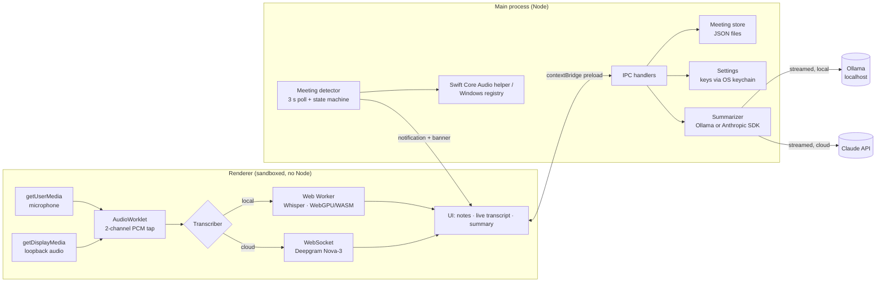

# Dictated

**Bot-free meeting transcription and AI notes for macOS and Windows.**

Dictated listens to your calls the way you do, through your microphone and your computer's speakers, so no "notetaker bot" ever joins the meeting. It transcribes on-device with Whisper or in the cloud with Deepgram, tells you who said what, notices when a Zoom, Teams or Meet call starts, and turns your rough notes plus the transcript into a clean summary with decisions and action items, using a free local model (Ollama) or Claude.

> Built with Electron · TypeScript · Web Audio · Transformers.js (Whisper) · Deepgram · Ollama · Claude API · Swift/Core Audio

<!-- Add a screenshot or GIF here:  -->

---

## Table of contents

- [Features](#features)
- [How each feature works](#how-each-feature-works)
- [Architecture](#architecture)
- [Security and privacy](#security-and-privacy)
- [Engineering decisions and trade-offs](#engineering-decisions-and-trade-offs)
- [Testing](#testing)
- [Getting started](#getting-started)
- [Project structure](#project-structure)
- [Known limitations and roadmap](#known-limitations-and-roadmap)

---

## Features

| Feature | What it does |
|---|---|
| **Bot-free capture** | Records your mic and the system audio output as two separate channels. Nothing joins the call. |
| **"Me" vs "Them" labels** | Speaker labels come from the audio channel, so no diarization model is needed. |
| **Switchable transcription** | On-device Whisper (private, free, offline) or Deepgram Nova-3 streaming (fast, accurate), chosen in Settings. |
| **Live transcript** | Words appear while people talk; interim results are shown in italics when using Deepgram. |
| **Echo removal** | When you're not on headphones, words the mic picks up from your speakers are detected and removed. |
| **Meeting auto-detection** | Notices when Zoom, Teams, Webex, Slack, FaceTime, Discord or a browser call starts using the mic, and offers to start; stops automatically when the call ends. |
| **Switchable AI summaries** | Merges your notes with the transcript into a summary, key points, decisions, action items and open questions, streamed live. Runs free and private on your machine with Ollama, or on Claude for the best quality. |
| **Local-first storage** | Meetings are JSON files on your machine; API keys are encrypted with the OS keychain. |

## How each feature works

### 1. Capturing system audio without a bot

Meeting bots exist because getting the *other* side of a call is hard. Dictated avoids them by recording the computer's **audio output** (loopback) alongside the microphone.

- The renderer calls the standard `getDisplayMedia()` API. The main process intercepts that request with `session.setDisplayMediaRequestHandler()` and answers with `audio: "loopback"`, so no screen-picker dialog appears and the video track is discarded right away (`src/main/main.ts`).
- **Windows** supports loopback natively through WASAPI.
- **macOS** needs Chromium features enabled at startup: Core Audio process taps on macOS 14.2+, ScreenCaptureKit audio on older versions. On macOS 14.2+ the OS asks for "Screen & System Audio Recording" permission.
- Both streams go into one `AudioContext`. A custom **AudioWorklet** (`pcm-worklet.ts`) runs on the real-time audio thread and posts 100 ms frames per channel. The main thread then downsamples them to the 16 kHz that speech models expect (`pcm.ts`).

### 2. Knowing who said what, for free

Because the mic and the system audio stay on **separate channels** for the whole pipeline, every transcript segment already knows its speaker: channel 0 is "Me", channel 1 is "Them". This is cheaper and more reliable than running speaker diarization on mixed audio.

### 3. Two transcription backends, one interface

Both backends implement the same `Transcriber` interface (`start / push / stop`), so the UI never knows which one is running.

**On-device: Whisper via Transformers.js** (`local-whisper.ts`, `whisper.worker.ts`)
- Runs in a **Web Worker** so inference never blocks the UI. It uses **WebGPU** when available and falls back to WebAssembly on the CPU.
- Whisper transcribes clips, not streams, so a voice-activity detector (`chunker.ts`) cuts audio into utterances at natural pauses. It is energy-based, adds a little pre-roll so first syllables aren't clipped, ignores sub-300 ms blips, and forces a cut after 15 s.
- The ONNX Runtime WebAssembly files ship inside the app, so nothing executable loads from a CDN. Model weights download once from Hugging Face and are cached.
- Known Whisper failure modes (`[BLANK_AUDIO]`, "Thank you." on silence) are filtered out.

**Cloud: Deepgram Nova-3 streaming** (`deepgram.ts`)
- One WebSocket carries **interleaved 16-bit stereo**. With `multichannel=true`, Deepgram returns a separate transcript per channel, which keeps the Me/Them split.
- Shows interim results live, sends keep-alives during long silences, and on stop sends `CloseStream` and waits for the final results before closing.
- The renderer never needs the long-lived API key. The main process exchanges it for a **60-second access token** (`deepgram-auth.ts`).

### 4. Removing speaker echo

Without headphones the mic hears the other participants through your speakers, so their words would appear twice. `dedupeEcho()` (`src/shared/transcript.ts`) drops a "Me" segment when its words overlap a "Them" segment from about the same moment (Jaccard similarity of word sets, within a ±2.5 s window). It's applied both to the on-screen transcript and to the text sent for summarization.

### 5. Detecting meetings automatically

The main process polls every 3 seconds for **which apps are using the microphone**, then maps them to known meeting apps (`src/main/meeting-detector/`).

- **macOS:** a small Swift helper (`native/macos/MicMonitor.swift`) asks Core Audio for its **process objects** and their `kAudioProcessPropertyIsRunningInput` flag (macOS 14+). That answers exactly "which bundle IDs are recording right now". On older macOS it falls back to "is any input device running" plus the process list.
- **Windows:** reads the registry key behind the taskbar's microphone indicator (`CapabilityAccessManager\ConsentStore\microphone`). An app whose `LastUsedTimeStop` is `0` is using the mic now.
- A pure **state machine** (`state.ts`) turns those polls into `detected` / `ended` events. It tolerates brief gaps (apps re-acquire the mic when you switch devices) and announces each call only once.
- Dedicated apps win over browsers, so a Zoom call isn't reported as "Chrome". Dictated's own capture is always excluded.
- On detection you get a native notification and an in-app banner. When the call ends, recording stops and a summary is generated automatically.

### 6. AI summaries: local by default, Claude optional

Both summary engines share one system prompt and one prompt builder, so they produce the same Markdown structure and the UI doesn't care which one ran. The default makes Dictated **free and fully private end to end**: on-device Whisper plus a local model means no audio or text leaves the computer.

**Local (Ollama).** `src/main/ollama.ts` talks to the [Ollama](https://ollama.com) server on `127.0.0.1:11434` with plain `fetch`.

- **Streams** the reply as newline-delimited JSON. Network chunks can end mid-line, so the parser buffers the unfinished tail; a unit test splits a line mid-JSON to prove it.
- **Sizes the context window to the transcript.** Ollama's default window is only a few thousand tokens and silently drops the *start* of anything longer, which would lose the first half of a meeting. `contextWindowFor()` estimates the tokens needed, then caps the window so the KV cache still fits on an 8 GB laptop.
- Settings lists the models you have installed (`/api/tags`), and errors explain the fix ("run `ollama pull llama3.2`") instead of showing a raw HTTP status.
- Strips inline `<think>` blocks that some reasoning models emit.

**Cloud (Claude).** `src/main/summarizer.ts` sends the meeting title, **your notes** (treated as the outline of what mattered) and the de-echoed transcript to **Claude Opus 5.5** via the official Anthropic TypeScript SDK.

- **Streams** the response so the summary renders while it is being written; tokens are forwarded to the UI over IPC.
- Uses **adaptive thinking** with `effort: "medium"`, a good balance of quality and cost for summarization.
- Enables **server-side refusal fallbacks**, so if a safety classifier declines, the API retries on a fallback model inside the same request.
- The system prompt asks for fixed Markdown sections and forbids inventing facts not supported by the notes or transcript. The transcript and notes are wrapped in XML tags so the model can tell instructions from data.
- SDK errors (bad key, rate limits, network) are mapped to messages users can act on.
- The Markdown is rendered by a tiny renderer (`src/shared/markdown.ts`) that **escapes all HTML first**, so model output can never inject markup into the page.

## Architecture



**Process split:** the renderer does real-time audio and UI. The main process owns everything privileged: the file system, secrets, network calls that need keys, and OS probes. The preload script exposes a small, typed API (`DictatedApi` in `src/shared/types.ts`) through `contextBridge` and nothing else.

## Security and privacy

- **Sandboxed renderer:** `contextIsolation: true`, `sandbox: true`, `nodeIntegration: false`. The UI can only call the functions in the preload bridge.
- **Strict Content-Security-Policy:** scripts only from the app itself, network only to Deepgram and Hugging Face, no inline scripts.
- **Custom `app://` protocol** instead of `file://`, with path-traversal protection, so the page has a real origin and can be cross-origin isolated for multithreaded WebAssembly.
- **API keys** are encrypted with Electron `safeStorage` (macOS Keychain / Windows DPAPI). They're written with `0600` permissions and never sent to the renderer. Deepgram gets a 60-second token instead.
- **Untrusted model output** is HTML-escaped before rendering.
- **Input validation:** meeting IDs are restricted to a safe character set so they can't be used to write outside the meetings folder.
- **Navigation lock:** the window can't navigate away from the app, and external links open in the system browser.
- **Private by default:** with on-device transcription, audio never leaves your computer. Audio is never saved to disk. Only the transcript is stored.
- **Consent:** recording people may require their consent where you live. Tell participants when you use Dictated.

## Engineering decisions and trade-offs

| Decision | Why | Trade-off |
|---|---|---|
| Electron + web audio instead of native audio addons | One codebase for macOS and Windows; loopback through a standard browser API; no C++ build chain | Less control than a native Core Audio / WASAPI addon (e.g. no hardware echo cancellation against system output) |
| Channel-based speaker labels | Free, instant, and accurate for the Me/Them split | Can't tell apart several remote speakers ("Them" is everyone) |
| Whisper in a Web Worker with WebGPU | Private and free, and fast on modern GPUs | First run downloads the model; CPU fallback is slower |
| Local LLM (Ollama) as the default summarizer | Free, private, no account needed | Small models write weaker summaries than Claude and are slower on older machines |
| Energy-based VAD | Tiny, dependency-free, easy to test | Less robust than a neural VAD in noisy rooms |
| Polling for meeting detection | Simple and robust across OS versions | Up to ~3 s detection latency |
| Pure functions for all logic | The state machine, parsers, chunker, echo removal and prompt builder are unit-tested without Electron | Slightly more plumbing between pure core and I/O shell |
| JSON files for storage | Transparent, easy to back up, no native modules | Not suited to thousands of meetings or full-text search |

## Testing

```bash
npm test               # 53 unit tests (Vitest)
npm run typecheck      # strict TypeScript, including noUncheckedIndexedAccess
npm run smoke          # boots the real Electron app hidden and fails on any console error
npm run smoke:whisper  # also loads Whisper in the worker and transcribes a clip
```

The unit tests cover:
- the meeting-detection state machine and app matching;
- the Windows registry and macOS helper parsers;
- PCM resampling and interleaving;
- the voice-activity chunker;
- Deepgram URL building, message parsing and token exchange;
- echo removal;
- the summary prompt;
- Ollama streaming (including lines split across chunks), error messages and context sizing;
- the Markdown renderer's HTML escaping;
- encrypted settings and meeting storage, including path-traversal rejection.

## Getting started

**Requirements:** Node.js 22+. On macOS, the Xcode Command Line Tools (`xcode-select --install`) to compile the meeting-detection helper.

```bash
git clone https://github.com/<your-username>/dictated.git
cd dictated
npm install
npm start
```

Then open **Settings** and:
1. Choose **On-device** transcription (no key needed), or **Cloud** with a [Deepgram API key](https://console.deepgram.com).
2. For summaries, either:
   - **Local (free, default):** install [Ollama](https://ollama.com), then run `ollama pull llama3.2`. On a machine with 16 GB of RAM or more, a larger model such as `qwen3:8b` writes noticeably better notes.
   - **Cloud:** choose Claude and add an [Anthropic API key](https://console.anthropic.com) (pay per use, typically a few cents per meeting).

**Permissions:**
- **macOS:** allow Microphone, and Screen & System Audio Recording, for Dictated (in development the app appears as "Electron").
- **Windows:** allow microphone access in Settings › Privacy & security › Microphone.

## Project structure

```
src/
  main/                 Electron main process (Node)
    main.ts             app lifecycle, window, app:// protocol, loopback handler, IPC
    summarizer.ts       shared summary prompt + Claude streaming and error mapping
    ollama.ts           local summaries via Ollama: NDJSON streaming, context sizing
    deepgram-auth.ts    API key → short-lived token exchange
    settings.ts         settings + keychain-encrypted secrets
    storage.ts          meeting JSON store
    meeting-detector/   which app holds the mic → "call started/ended"
  preload/preload.ts    typed contextBridge API
  renderer/             sandboxed UI
    app.ts              UI controller
    audio/              capture, AudioWorklet, PCM helpers
    transcription/      Transcriber interface, Deepgram, Whisper worker, chunker
  shared/               types, IPC channel names, transcript + markdown helpers
native/macos/           Swift Core Audio helper for mic-usage detection
scripts/build.mjs       esbuild bundling + Swift compile
tests/                  Vitest unit tests
```

## Known limitations and roadmap

- [ ] **Installers:** package signed, notarized builds with electron-builder (`.dmg` / `.exe`).
- [ ] **Multiple remote speakers:** "Them" is everyone on the call. Next step is on-device diarization of the system channel, or reading the active speaker from the meeting app's UI via the Accessibility APIs.
- [ ] **Echo cancellation:** replace text-level echo removal with an acoustic echo canceller (e.g. WebRTC AEC3) fed with the loopback signal.
- [ ] **Calendar:** name meetings and attendees from Google or Outlook calendar.
- [ ] **Search:** full-text search across past meetings, and "chat with your meetings".
- [ ] **Dictation hotkey:** push-to-talk anywhere, pasting text into the focused app.

---

Dictated is an independent project written from scratch. It's inspired by the category of bot-free AI notetakers, but contains no code or assets from any other product. Licensed under the [MIT License](LICENSE).
